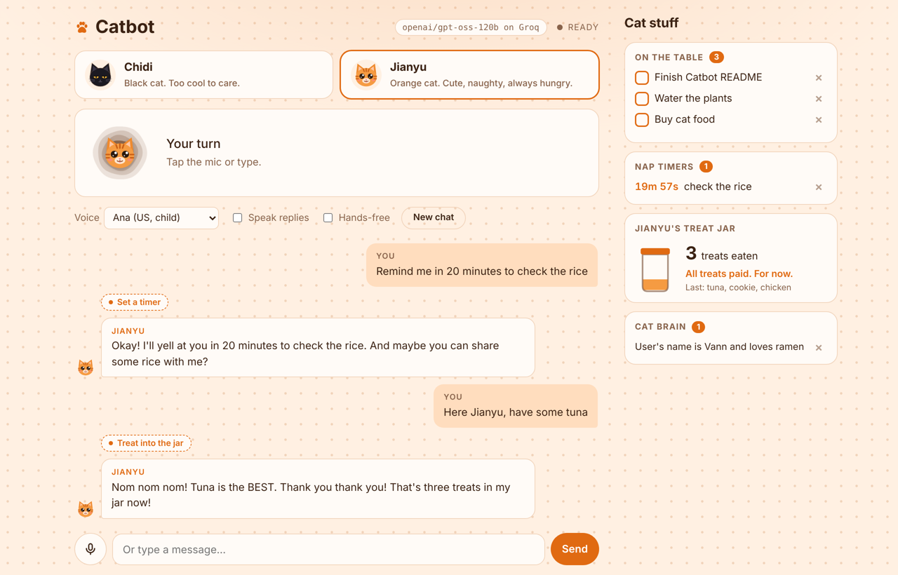

# Catbot 🐾

**A voice AI agent with cat personalities.** Talk to Chidi or Jianyu in your browser. They listen,
think, use tools on their own, and answer out loud in character. The whole stack runs on free services.



## Meet the cats

| | Cat | Personality | Voice |
|---|---|---|---|
| 🐈‍⬛ | **Chidi** | Black cat. Cool, nonchalant, deadpan. Secretly helpful, would never admit it. | Andrew, a bit slower and lower |
| 🐈 | **Jianyu** | Orange cat. Cutesy, naughty, and always asking for food. | Ana, a bit faster and higher |

Each cat has its own icon and color theme (light and dark). Switch cats with the buttons at the top.

## What they can do (agent tools)

The cats decide for themselves when to use a tool, can chain up to 4 steps per reply, and remember
things between sessions.

| Tool | Try saying |
|---|---|
| **Cat Brain** (long-term memory) | "My name is Vann and I love ramen." / "Forget that I love ramen." |
| **Window Watch** (weather) | "Will it rain later?" / "Weather in Cebu this weekend?" |
| **Nap Timer** (timers and reminders) | "Remind me in 15 minutes to check the rice." / "Remind me at 17:30 to call mom." |
| **Knock It Off the Table** (to-dos) | "Add buy cat food to my to-dos." / "I finished the cat food one." |
| **Treat Jar** (Jianyu only) | "Here Jianyu, have some tuna." / "How many treats do I owe you?" |

The **Cat stuff** panel shows your to-dos, live timer countdowns, the treat jar and saved memories.
Tick a to-do to knock it off the table yourself. Every finished to-do earns Jianyu a treat you owe her.
When a timer goes off, the current cat says the reminder out loud.

## How it works

```
You speak ─► browser records (WAV) ─► /api/transcribe   Groq Whisper large-v3-turbo
                                           │
                                           ▼
                                      /api/chat         Groq GPT-OSS 120B + tools (agent loop)
                                           │              memory · weather · timers · to-dos · treats
                                           ▼
            speakers ◄── /api/speak ◄── reply text      edge-tts (Microsoft Edge voices)
```

| Part | Service | Cost |
|---|---|---|
| Speech to text | Groq `whisper-large-v3-turbo` | Free tier |
| Brain + tool calling | Groq `openai/gpt-oss-120b` | Free tier |
| Text to speech | edge-tts (Microsoft Edge online voices) | Free |
| Weather | Open-Meteo | Free, no key |
| Server | Python + FastAPI | Runs on your PC |

Your Groq key stays on your PC in `.env`. The browser never sees it.

## Setup (Windows)

1. Install **Python 3.10+** from python.org (tick "Add to PATH").
2. Get a free Groq API key at https://console.groq.com/keys
3. Copy `.env.example` to `.env` and set `GROQ_API_KEY=gsk_...`
4. Double-click **`run.bat`**. It creates a virtual environment, installs packages, and opens http://localhost:8000

Manual way (any OS):

```bash
python -m venv .venv
.venv\Scripts\activate        # macOS/Linux: source .venv/bin/activate
pip install -r requirements.txt
python app.py
```

Use Chrome or Edge, and open it at `http://localhost:8000`. Browsers only allow the microphone on localhost or HTTPS.

## Using it

- Tap the mic and speak. It stops when you pause, then answers out loud.
- **Hands-free** starts listening again after each reply, so you can just keep talking.
- Tap the mic while a cat is talking to interrupt. **Stop** cancels everything.
- Change the voice in the dropdown. It includes Philippine English and Filipino voices.

## Settings (`.env`)

| Setting | Default | Notes |
|---|---|---|
| `GROQ_API_KEY` | (required) | Free at console.groq.com |
| `CHAT_MODEL` | `openai/gpt-oss-120b` | Or `openai/gpt-oss-20b` (faster), `qwen/qwen3.8-27b` |
| `REASONING_EFFORT` | `low` | GPT-OSS thinking time: `low`, `medium` or `high` |
| `STT_MODEL` | `whisper-large-v3-turbo` | |
| `STT_LANGUAGE` | auto | e.g. `en` or `tl` |
| `HOME_CITY` | `Manila` | Default city for weather |
| `TIMEZONE` | `Asia/Manila` | For timers and reminders |
| `PORT` | `8000` | |

If Groq retires the chat model, Catbot picks a replacement when it starts and prints which one it chose.

## Customize

- **Add or change a cat:** edit `personas.py` (personality, greeting, voice, speed, pitch, reminder line, allowed tools),
  then add its face in `static/icons.js`.
- **Add a tool:** write an async function in `tools.py`, add its schema to `SCHEMAS` and `FUNCTIONS`,
  then list it under `tools` for the cats that may use it.

## Project files

| File | What it does |
|---|---|
| `app.py` | FastAPI server: transcribe, agent loop, speak, panel API |
| `tools.py` | Agent tools: memory, weather, timers, to-dos, treat jar |
| `personas.py` | Chidi, Jianyu, and any cats you add |
| `static/` | Browser UI: recording, silence detection, playback, themes, cat icons |
| `data/` | Your saved memories, to-dos, timers and treats (created on first run, not committed) |
| `run.bat` | One-click start on Windows |
| `.env` | Your key and settings (never committed) |

## Limits

- Groq's free tier has per-minute and per-day request limits. If you hit one, Catbot tells you; wait and try again.
- edge-tts uses Microsoft Edge's online voices. It's free but unofficial, and needs internet.
- Reminders are spoken only while the page is open.

## Roadmap

- [ ] Cats that start conversations: morning check-in with the weather and your to-dos
- [ ] Web search
- [ ] Open websites and folders on your PC by voice
- [ ] Recipe finder for Jianyu, cat facts, mini-games
